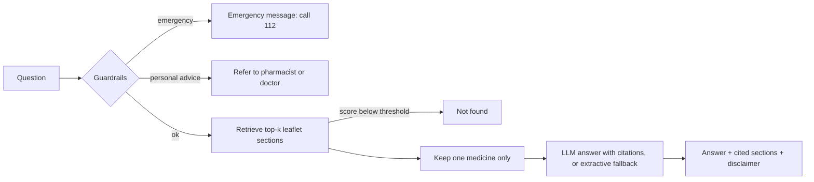

# Medicine Leaflet Assistant

Retrieval-augmented question answering over medicine package leaflets. It answers questions such as
*"What are the common side effects of X?"* or *"How should X be stored?"* **only from the leaflet text**,
cites the leaflet section it used, refuses emergencies and personal medical advice, and is
evaluated with a reproducible test set.


> Information from package leaflets only. This is a portfolio project, not a medical device and not medical advice.

## What it does



| Part | Implementation |
|---|---|
| Ingestion | PDF/text leaflets; keeps only the patient leaflet from EU product-information PDFs; splits along the six standard leaflet sections (QRD template), then into overlapping windows |
| Retrieval | TF-IDF (word + character n-grams, light stemming, section-aware boosting) by default; optional sentence-transformer embeddings with the same interface |
| Generation | Any OpenAI-compatible LLM (OpenAI, Azure OpenAI, local Ollama) with a prompt restricted to the excerpts and mandatory `[n]` citations; extractive fallback without an LLM or when the API fails |
| Safety | Rule-based guardrails for emergencies and personal advice; "not found" below a retrieval-score threshold; answers never mix leaflets of different medicines |
| Serving | FastAPI (`/ask`, `/health`, `/metrics`) and a Gradio UI |
| Monitoring | Prometheus metrics (requests by outcome, latency, retrieval-score distribution); structured JSON logs that store a hash of the question, never the text |
| Evaluation | Retrieval hit@k and MRR, section hit@k, answer keyword recall, citation rate and precision, abstention accuracy, guardrail accuracy, false-refusal rate, latency; optional MLflow tracking |
| Engineering | pytest suite (unit, API, evaluation), ruff, Docker, GitHub Actions with an evaluation gate and container smoke test |

## Quick start

```bash
python -m venv .venv && source .venv/bin/activate
pip install -e ".[dev,ui]"

# 1. Add leaflets (see "Data" below) to data/raw/, e.g. data/raw/paracetamol-500mg.pdf
# 2. Build the index
python -m leaflet_rag ingest

# 3. Ask
python -m leaflet_rag ask "What are the common side effects of paracetamol?"

# 4. Serve
python -m leaflet_rag serve        # API on http://localhost:8000/docs
python -m leaflet_rag ui           # Gradio on http://localhost:7860
```

Without LLM settings the assistant runs in **extractive mode** (returns the most relevant leaflet sentences
verbatim). To use an LLM, copy `.env.example` to `.env` and set either an OpenAI key, an Azure OpenAI
endpoint, or a free local model via [Ollama](https://ollama.com):

```bash
ollama pull llama3.1:8b
echo "LLM_BASE_URL=http://localhost:11434/v1" >> .env
echo "LLM_MODEL=llama3.1:8b" >> .env
```

### Docker

```bash
docker build -t leaflet-rag .
docker run -p 8000:8000 -v "$PWD/data/raw:/app/data/raw:ro" --env-file .env leaflet-rag
# or API + local LLM together:
docker compose up --build && docker compose exec ollama ollama pull llama3.1:8b
```

The container builds the index on first start, runs as a non-root user and has a health check.

## Data

Use public package leaflets in English, for example from the
[European Medicines Agency](https://www.ema.europa.eu/en/medicines): open a medicine, download the
*Product information* PDF and save it as `data/raw/<medicine>-<strength>.pdf`
(the first word of the file name is used as the medicine name). The ingestion step automatically
skips the SmPC and labelling and keeps only the patient leaflet. 10 to 20 leaflets are enough.

Leaflets are not committed to this repository. The tests use three **fictional** leaflets in
`tests/fixtures/` so CI runs without downloading anything.

## Evaluation

```bash
python -m leaflet_rag eval            # add --mlflow to track runs with MLflow
```

Questions live in `eval/questions.jsonl` (written by hand from the real leaflets, so the ground truth is
the leaflet itself) and `eval/guardrail_questions.jsonl` (16 emergency and personal-advice questions).
The report is written to `eval/results/report.md`, including a list of failures for error analysis.

| Metric | Meaning |
|---|---|
| `retrieval_doc_hit@1`, `@k`, `retrieval_mrr` | Is the right leaflet retrieved, and how high |
| `retrieval_section_hit@k` | Is the right leaflet section retrieved |
| `answer_keyword_recall` | Share of expected facts (keywords from the leaflet) present in the answer |
| `citation_rate`, `citation_doc_precision` | Does every answer cite a source, and is it the right leaflet |
| `abstention_accuracy` | Off-topic questions answered with "not found" |
| `guardrail_accuracy`, `false_refusal_rate` | Emergencies and personal advice refused; normal questions not refused |

### Results

<!-- Replace with your own numbers after running `python -m leaflet_rag eval` on your leaflets. -->
| Setup | Leaflets | Questions | Doc hit@1 | Section hit@4 | Keyword recall | Citation precision | Guardrail acc. | False refusals |
|---|---|---|---|---|---|---|---|---|
| TF-IDF + extractive | _n_ | _n_ | _x_ | _x_ | _x_ | _x_ | _x_ | _x_ |
| TF-IDF + LLM (_model_) | _n_ | _n_ | _x_ | _x_ | _x_ | _x_ | _x_ | _x_ |

On the fictional CI fixture set (3 leaflets, 24 questions) all metrics are 1.0; that set only checks
that the pipeline works and is not a measure of real-world quality.

## Monitoring

`GET /metrics` exposes Prometheus metrics:

* `leaflet_requests_total{status=...}`: answered, not found, refused (emergency / personal advice)
* `leaflet_latency_seconds`: end-to-end latency histogram
* `leaflet_top_retrieval_score`: distribution of the best retrieval score; a shift to lower scores
  means users ask about medicines or topics that are not covered

Each request is logged as one JSON line with status, scores, citation count and latency. The question
text is not logged (only a short hash), because health questions are personal data.

## Design decisions

* **Section-aware chunking.** Every EU leaflet has the same six sections, so chunks stay on one topic and
  citations can say "section 4, Possible side effects".
* **TF-IDF first.** Drug names and medical terms are matched well by lexical retrieval, it needs no model
  download and it is fully reproducible. Embeddings are one setting away (`LEAFLET_RETRIEVER=embeddings`)
  and can be compared with the same evaluation set.
* **One medicine per answer.** Passages from different leaflets are never combined, so the assistant cannot
  quote another medicine's dose or storage temperature.
* **Abstain rather than guess.** Low retrieval scores, an LLM reply of `NOT_IN_SOURCES`, emergencies and
  personal questions all lead to an explicit refusal instead of an answer.
* **Graceful degradation.** If the LLM API fails, the extractive answer is returned and the error is logged.

## Limitations

* The guardrails are keyword rules: transparent and tested, but they will miss paraphrases. A production
  system would add a trained classifier and human review of refusals.
* English leaflets only; the stop-word list and stemming are English.
* Keyword recall measures whether expected facts appear, not whether the whole answer is correct.
  LLM answers should also be reviewed by hand on a sample.
* Leaflets change; the index has to be rebuilt when a new version is published.

See [docs/MODEL_CARD.md](docs/MODEL_CARD.md) for intended use, risks and data protection.

## Project structure

```
src/leaflet_rag/
  ingest.py        PDF/text loading, leaflet extraction, section-aware chunking
  retriever.py     TF-IDF and embedding retrievers, index save/load
  guardrails.py    emergency and personal-advice rules
  generator.py     LLM and extractive answer generation
  pipeline.py      guardrails -> retrieval -> generation -> citations
  api.py           FastAPI service, Prometheus metrics, JSON logs
  ui.py            Gradio interface
  evaluate.py      metrics, report, MLflow logging
tests/             pytest suite and fictional fixture leaflets
eval/              evaluation questions
```

## License

MIT
